<a href="https://madaraka.work">
  <picture>
    <source media="(prefers-color-scheme: dark)" srcset="assets/banner-dark.webp">
    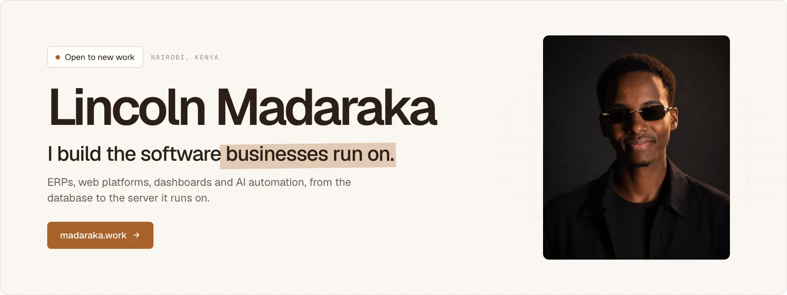
  </picture>
</a>

  
  
   
  
  

  <a href="#what-i-build"><b>What I build</b></a> &nbsp;&middot;&nbsp;
  <a href="#selected-work"><b>Selected work</b></a> &nbsp;&middot;&nbsp;
  <a href="#stack"><b>Stack</b></a> &nbsp;&middot;&nbsp;
  <a href="#experience"><b>Experience</b></a> &nbsp;&middot;&nbsp;
  <a href="#lets-build-something"><b>Contact</b></a>

 

<picture>
  <source media="(prefers-color-scheme: dark)" srcset="assets/stats-dark.webp">
  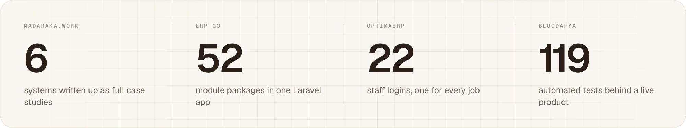
</picture>

 

I build and run production systems end to end: Laravel ERPs, internal dashboards, client platforms and the servers underneath them. Most of my work runs from database design, through deployment, to whoever has to keep it alive afterwards. Right now that means leading software and technology operations at Red Giant Media Agency in Nairobi, and building for clients on Upwork.

> **Need an ERP, a platform or an automation built?** I take it from the first conversation to the server it runs on, with support after launch. [Start a conversation &rarr;](https://madaraka.work/contact)

 

## What I build

<a href="https://madaraka.work/services">
  <picture>
    <source media="(prefers-color-scheme: dark)" srcset="assets/services-dark.webp">
    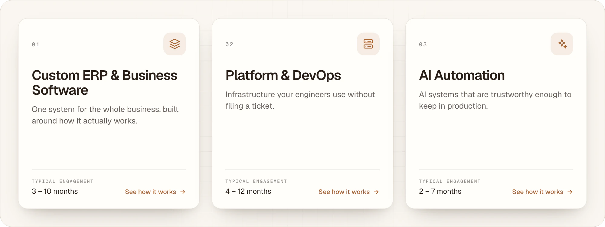
  </picture>
</a>

 

## Selected work

> Talk is cheap. Show me the product.

 

### 01 &nbsp;/&nbsp; BloodAfya

<a href="https://bloodafya.madaraka.work">
  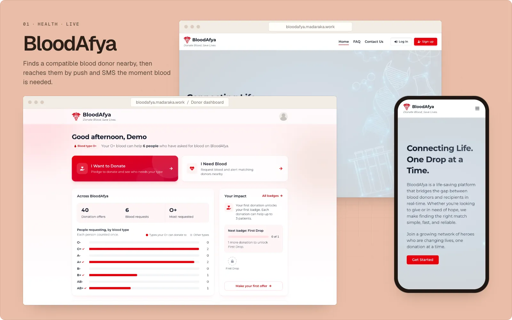
</a>

  
  

**A live platform that finds a compatible blood donor nearby, then reaches them by push and SMS the moment blood is needed.** Donors are ranked by ABO/Rh compatibility, distance and urgency, hospitals track their blood stock, and every channel is built so one failure never stops a match. You can sign in and try it as a donor or a recipient.

<table>
  <tr>
    <td width="50%">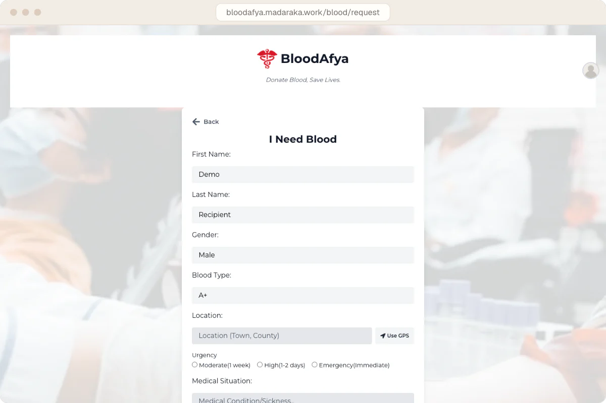 <b>Ask for blood</b>: location and urgency go in, and the matcher ranks compatible donors within 20 km</td>
    <td width="50%">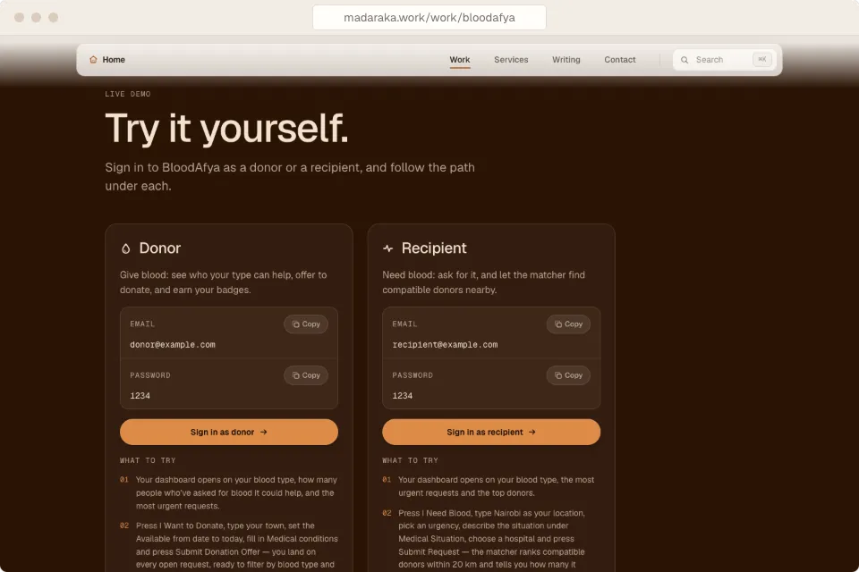 <b>Try it yourself</b>: shared donor and recipient logins with a step-by-step tour</td>
  </tr>
</table>

  
<b>How it is built</b>

   

- **Ranks donors the way a blood bank would.** An exact blood type ranks above a compatible one, distance is measured with the Haversine formula inside 20 km, and urgency lifts the score (1.2x high, 1.5x emergency). The scoring is a pure function with its own unit tests.
- **Three alert channels, none of them a blocker.** Web Push and SMS go out in parallel when a request is raised; push and email follow for everything after. A failed channel is logged, never thrown, so one broken gateway cannot stop a match.
- **Blood stock that follows the donations.** Hospitals track stock by lot, blood type and expiry. A completed match draws it down and warns the hospital when it runs low.
- **Keys encrypted, sessions signed.** SMS, email and push credentials are stored in PostgreSQL under AES-256-GCM, and every protected action checks the caller's role on the server.
- **A public demo that cannot reach a real person.** Test accounts only alert other test accounts, by push, and reset to a clean state every 20 minutes.
- **119 automated tests.** 110 Vitest unit tests and 9 Playwright end-to-end runs.

**Stack:** Next.js · React · TypeScript · PostgreSQL · Tailwind CSS · Web Push · Vitest · Playwright · Vercel

 

### 02 &nbsp;/&nbsp; ERP Go

<a href="https://madaraka.work/work/erpgo">
  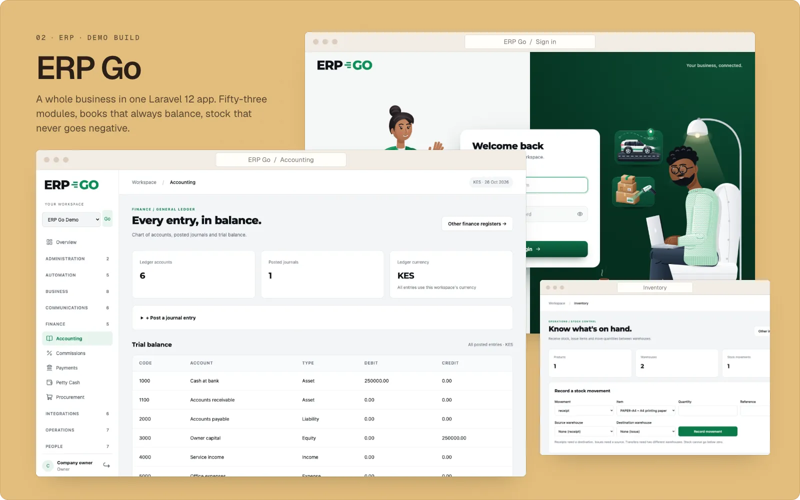
</a>

  
  

**A whole business in one Laravel 12 app: accounting, stock, people, sales, projects and more, as 52 module packages.** Books that always balance, stock that cannot go below zero, and roles enforced on the server for every page, export and approval. Based on WorkDo's ERPGo and written independently, one module at a time.

<table>
  <tr>
    <td width="50%">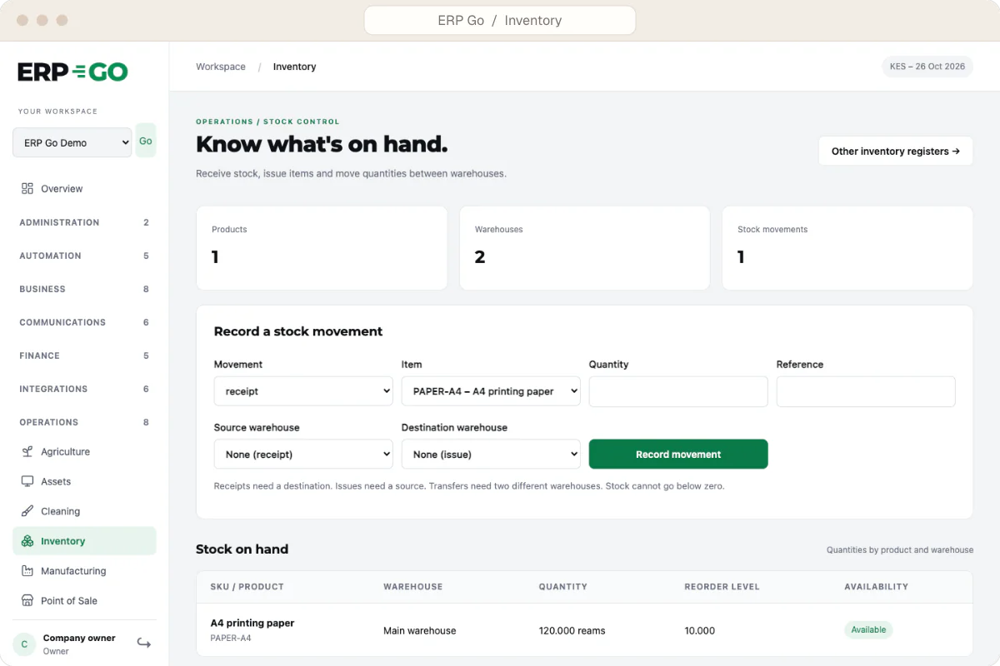 <b>Inventory</b>: receipts, issues and warehouse transfers that never go below zero</td>
    <td width="50%">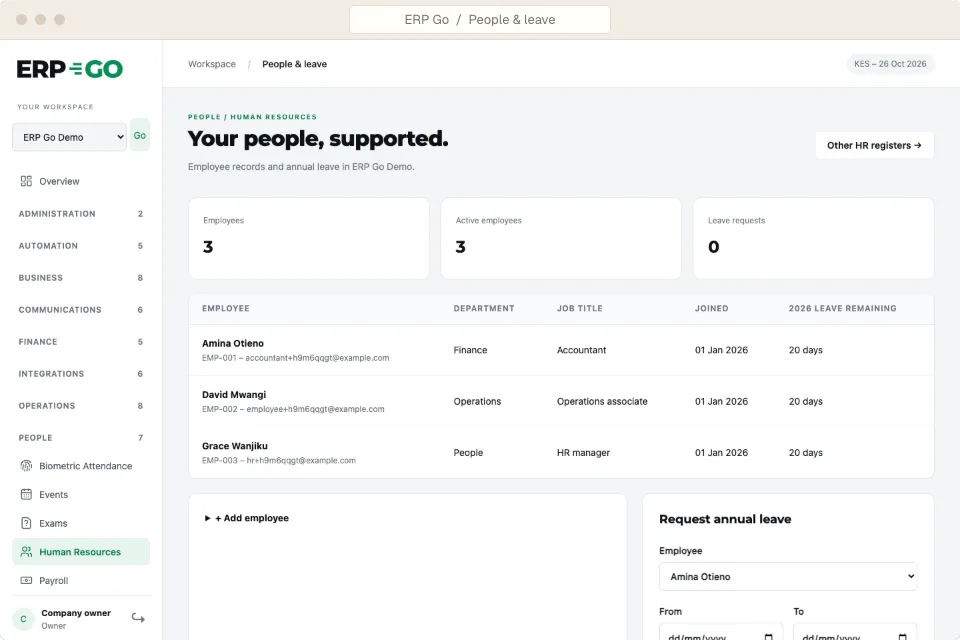 <b>People &amp; leave</b>: employee records, leave balances and manager review</td>
  </tr>
  <tr>
    <td width="50%">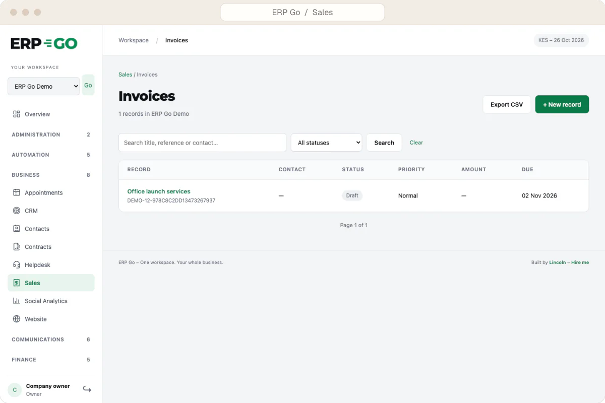 <b>Sales</b>: invoices with search, status filters, CSV export and approvals</td>
    <td width="50%">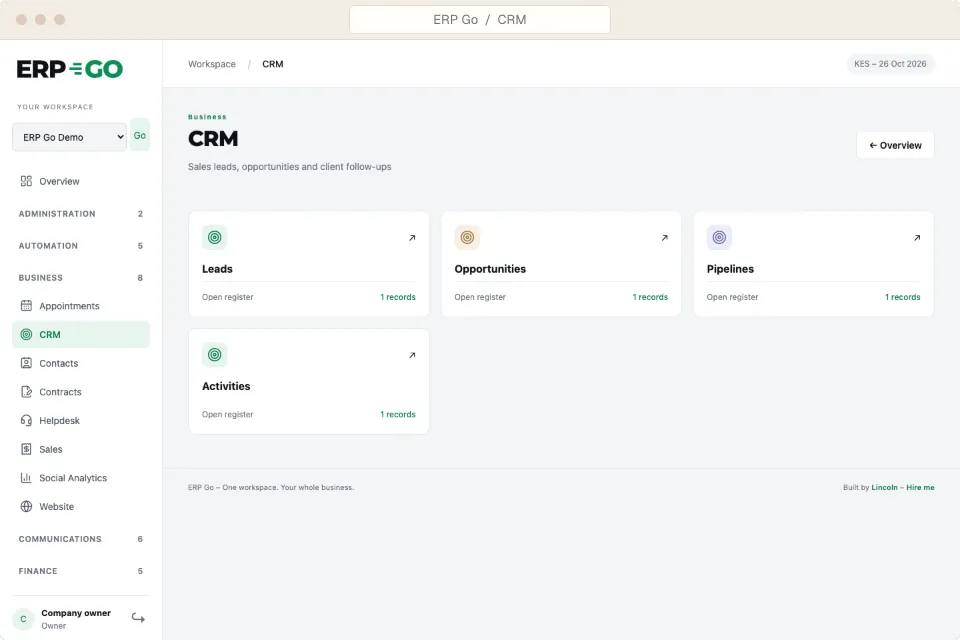 <b>CRM</b>: leads, opportunities, pipelines and activities</td>
  </tr>
</table>

  
<b>How it is built</b>

   

- **A package for every business area.** Each of the 52 areas is its own Composer package with a manifest. One module registry reads them all, so a new module never touches the core.
- **Books that always balance.** Money is stored as whole cents, a journal posts only when its debits equal its credits, posted entries are never edited, and the trial balance is added up live.
- **Stock that cannot go below zero.** Per-warehouse quantities are kept in thousandths of a unit. Receipts, issues and transfers each run in one transaction, and a movement that would leave a warehouse short is refused with the reason.
- **Roles that hold on the server.** Nine roles decide who can see, export and approve what. Nobody can approve their own request or their own leave.
- **Useful while it grows.** Modules without their own engine yet share one register with search, filters, CSV export, approvals and a full audit history.

**Stack:** PHP 8.2 · Laravel 12 · MySQL · JavaScript · Vite

 

### 03 &nbsp;/&nbsp; OptimaERP

<a href="https://madaraka.work/work/optimaerp">
  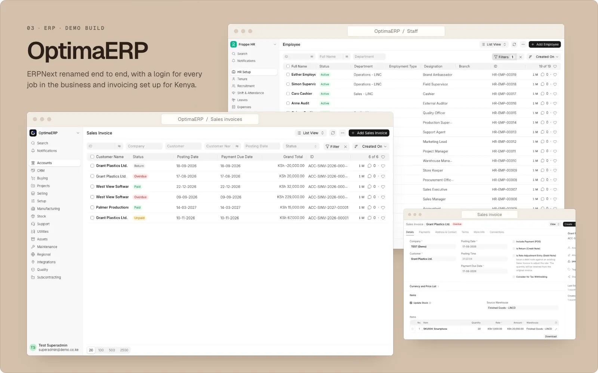
</a>

  
  

**ERPNext, the open-source ERP, renamed end to end and set up so a business can try it as each of its own staff.** A login for every job, from a read-only CEO to a cashier fenced to their own sales, with invoicing set up for the Kenyan market. ERPNext's GPL licence, credits and links are kept exactly where they were; only the name changed.

<table>
  <tr>
    <td width="50%">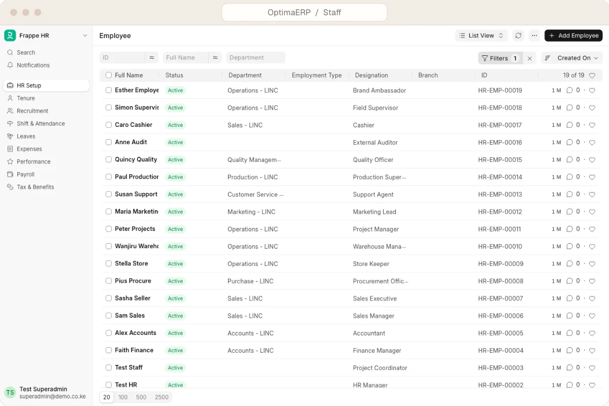 <b>Staff</b>: nineteen demo employees, each with their own department and job title</td>
    <td width="50%">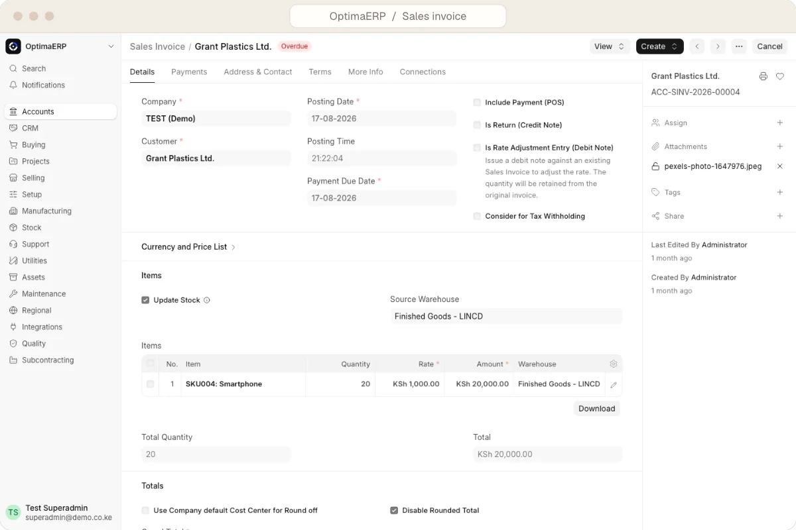 <b>Sales invoice</b>: customer, posting date, stock warehouse and line items in KSh</td>
  </tr>
</table>

  
<b>How it is built</b>

   

- **Renamed all the way through.** App, Python package, JavaScript namespace and asset paths, with Frappe HR rewired to depend on it. The rename runs from a script, so it is re-run rather than redone when ERPNext moves on.
- **A login for every job.** 22 demo logins built from role profiles, from a read-only CEO to a cashier fenced to their own sales. Customer, supplier and employee portals each see only their own records.
- **Nothing a demo user can break.** The CEO role can read, report and export on 28 document types and write on none. Delete rights came off sixteen records a demo depends on, so any login can be handed over mid-meeting.
- **Invoices that fit the local market.** KSh, a letter head on every document, 16% VAT on by default, M-Pesa as a payment method, and PDF printing through a bundled Chromium.

**Stack:** Frappe · Python · PostgreSQL · Redis · JavaScript

 

### 04 &nbsp;/&nbsp; madaraka.work

<a href="https://madaraka.work">
  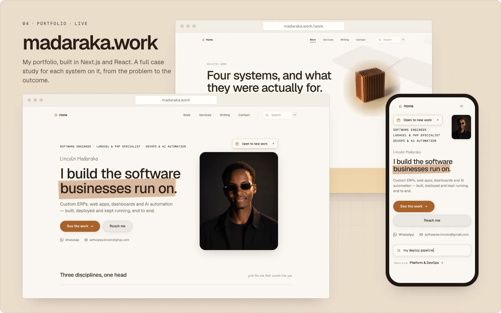
</a>

  

**The full story behind everything on this page.** Every system gets a written case study with its architecture and screenshots, and most have a recorded walkthrough. I built the site in Next.js and React to learn that stack properly instead of reading about it.

<table>
  <tr>
    <td width="50%">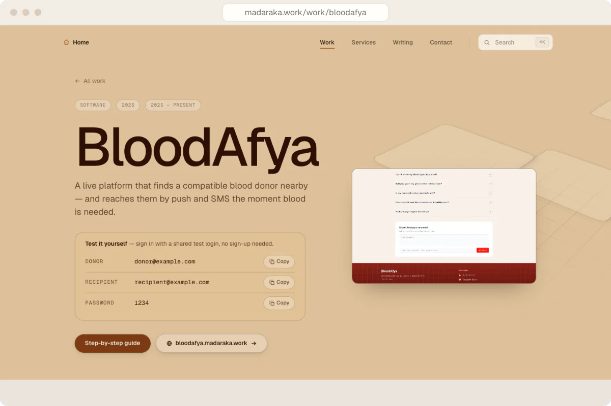 <b>Case studies</b>: the problem, the constraints, the approach, the architecture and the outcome</td>
    <td width="50%">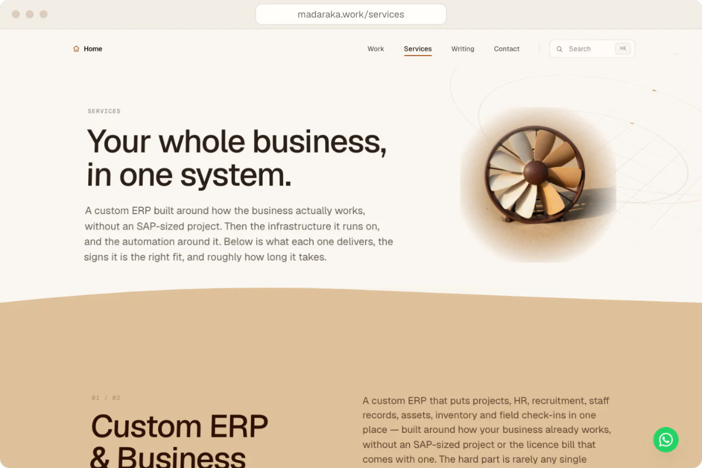 <b>Services</b>: what each engagement delivers, the signs it fits, and how long it takes</td>
  </tr>
</table>

  
<b>How it is built</b>

   

- **Try before you trust.** BloodAfya's case study hands out live demo logins with a guided tour.
- **Search everything.** Site-wide search with a command palette.
- **Built to be looked at.** 3D and motion work with Three.js, React Three Fiber and GSAP, tuned to settle instantly for people who prefer reduced motion.

**Stack:** Next.js 15 · React 19 · TypeScript · Three.js · GSAP · Motion

 

**Also on [madaraka.work](https://madaraka.work/work):** RedGiant Heartbeat, the Laravel ERP an agency runs its projects, people, assets and field check-ins on; Radian, a client platform at [rideradian.com](https://www.rideradian.com); and TinkaCode, learning tools for a children's coding and robotics school.

 

## Stack

<table>
  <tr>
    <td width="150"><b>Core</b></td>
    <td>
      <picture>
        <source media="(prefers-color-scheme: dark)" srcset="https://skillicons.dev/icons?i=php,laravel,mysql,js,html,css,linux,git,bash,wordpress&theme=dark">
        
      </picture>
    </td>
  </tr>
  <tr>
    <td width="150"><b>Shipped with recently</b></td>
    <td>
      <picture>
        <source media="(prefers-color-scheme: dark)" srcset="https://skillicons.dev/icons?i=ts,react,nextjs,postgres,tailwind,redis,py,threejs,vercel,vitest&theme=dark">
        
      </picture>
    </td>
  </tr>
  <tr>
    <td width="150"><b>Learning now</b></td>
    <td>
      <picture>
        <source media="(prefers-color-scheme: dark)" srcset="https://skillicons.dev/icons?i=nodejs,mongodb&theme=dark">
        
      </picture>
    </td>
  </tr>
</table>

Also: REST APIs, SSH and server administration, hosting and system migrations, dashboards and data visualisation, the OpenAI API and workflow automation.

 

## Experience

| When | Role | Where |
| --- | --- | --- |
| 2025 – present | Developer Operations & Software Automation Engineer | Red Giant Media Agency, Nairobi |
| 2024 – present | Software Engineer, freelance | Upwork, remote |
| 2024 | DevOps Trainee | CMC Motors Group, Nairobi |
| 2023 – 2024 | Software Developer & IoT Instructor | TinkaCode Kenya |
| 2022 – 2023 | Web Developer & Instructor | Digital Opportunity Trust Kenya |

**BSc Telecommunications and Information Engineering**, Kenyatta University, 2020 – 2025. Second Class Honours, Upper Division. 
**Diploma, Full-Stack Software Engineering**, ALX Africa, 2024 – 2025. Back-end specialisation.

  
<b>Certificates (6)</b>

   
  <table>
    <tr>
      <td width="33%" align="center" valign="top"><a href="project-3.png">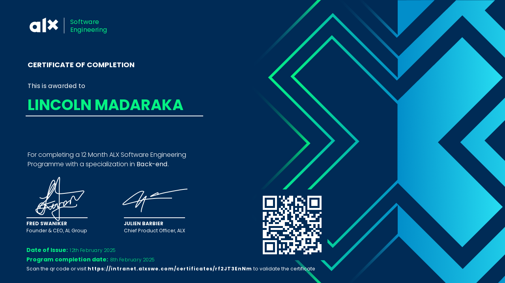</a> <b>ALX Software Engineering</b> 12-month programme, back-end specialisation. 2025</td>
      <td width="33%" align="center" valign="top"><a href="GCP_CERT.png">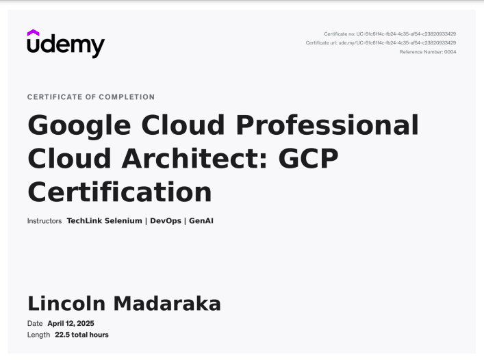</a> <b>Google Cloud Professional Cloud Architect</b> Udemy course. 2025</td>
      <td width="33%" align="center" valign="top"><a href="project-5.jpeg">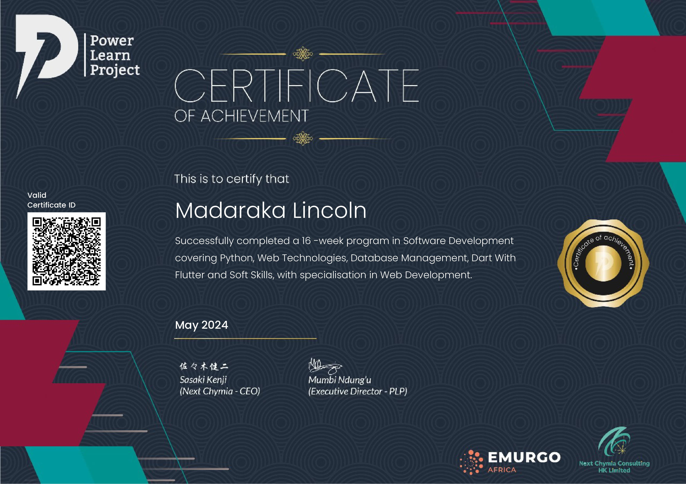</a> <b>Power Learn Project</b> 16-week software development programme, web specialisation. 2024</td>
    </tr>
    <tr>
      <td width="33%" align="center" valign="top"><a href="project-11.png">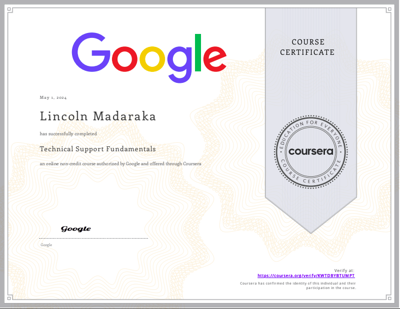</a> <b>Technical Support Fundamentals</b> Google, via Coursera. 2024</td>
      <td width="33%" align="center" valign="top"> <b>Artificial Intelligence for Cybersecurity</b> LinkedIn Learning. 2024</td>
      <td width="33%" align="center" valign="top"> <b>Git Essential Training</b> LinkedIn Learning. 2024</td>
    </tr>
  </table>

 

## Let's build something

<a href="https://madaraka.work/contact">
  <picture>
    <source media="(prefers-color-scheme: dark)" srcset="assets/cta-dark.webp">
    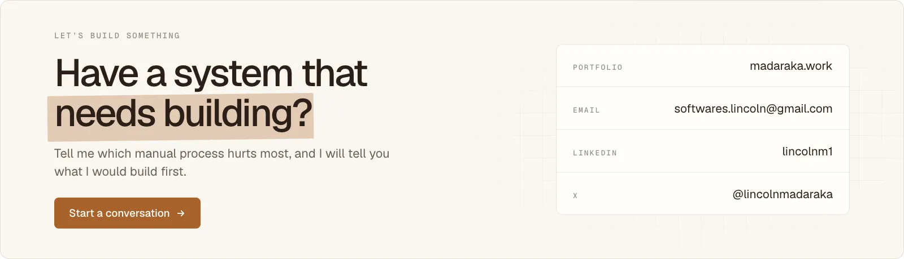
  </picture>
</a>

  
  

  
  

